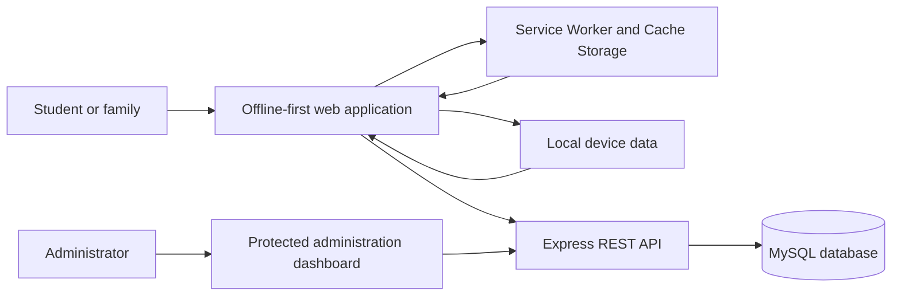
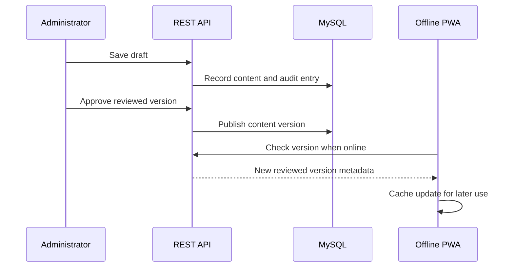

# System architecture

## Storage boundaries

The MySQL database is the authoritative source for public, reviewed content and administrative records. Cache Storage contains an offline copy of application files and approved public content. The household safety plan, kit progress, bookmarks and language preference stay on the device because they are private and must remain usable without Wi-Fi.

## Publishing workflow

## Security model

- Public guidance never requires authentication.
- Administration endpoints require a server-side session.
- Credentials and session secrets are supplied through local environment configuration and are excluded from Git.
- SQL values use prepared statements.
- Personal household data is not uploaded.
- Administrative changes are recorded in `audit_log`.
